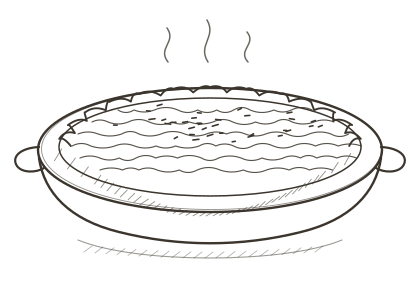

Slow-simmered lamb and garden vegetables under a golden crown of buttered mash — the kind of supper that fills a kitchen with warmth on a cold evening.

## Ingredients

- 1 kg floury potatoes, peeled and quartered
- 60 g butter
- 100 ml warm milk
- 1 egg yolk
- 1 tbsp olive oil
- 500 g minced lamb
- 1 large onion, finely diced
- 2 carrots, finely diced
- 2 cloves garlic, minced
- 2 tbsp tomato paste
- 1 tbsp plain flour
- 1 tbsp Worcestershire sauce
- 400 ml lamb or beef stock
- 2 sprigs thyme, 1 sprig rosemary
- 150 g frozen peas
- Salt and black pepper

## Method

{place=right width=42% wrap}

1. **Make the mash.** Boil the potatoes in well-salted water until completely tender, about 20 minutes. Drain and let them steam dry for a minute, then mash with the butter, warm milk and egg yolk until smooth. Season generously.
2. **Brown the lamb.** Heat the oil in a wide, heavy pan over a high heat and brown the lamb in batches, breaking it up as it colours. Lift it out with a slotted spoon.
3. **Soften the vegetables.** Lower the heat and cook the onion and carrots in the fat for 8–10 minutes, until *sweet and just catching* at the edges. Add the garlic for the final minute.
4. **Build the sauce.** Return the lamb with the tomato paste and flour and stir for a minute. Pour in the Worcestershire sauce and stock, add the herbs, and simmer for 15–20 minutes until *thick and glossy*. Fish out the herb stalks, fold in the peas and check the seasoning.
5. **Assemble.** Heat the oven to 200 °C (180 °C fan). Spoon the filling into a 2-litre baking dish and let it cool for a few minutes, so the mash sits on top rather than sinking.
6. **Top and bake.** Spread the mash over the filling, sealing it to the edges, then rough up the surface with a fork. Bake for 25–30 minutes until golden and bubbling at the edges. Rest for 10 minutes before serving.

> Rough up the mash with a fork — the ridges crisp beautifully.

{decor x=48% y=4 width=36% rotate=-9}
